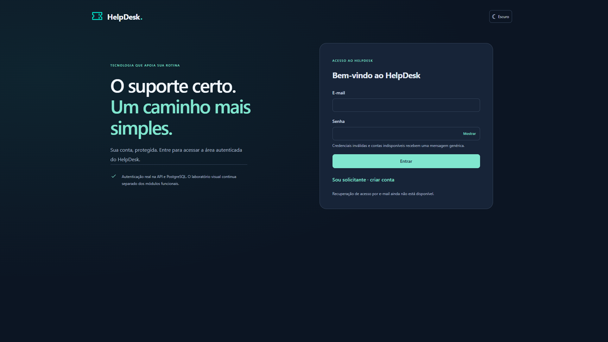
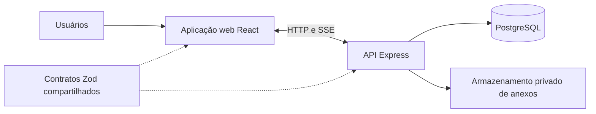

# HelpDesk

**Chamados de suporte de TI e acompanhamento de projetos em uma plataforma responsiva.**

O HelpDesk é um projeto de portfólio para organizar solicitações de suporte de TI, a operação dos serviços e o acompanhamento de projetos. Ele foi preparado para desenvolvimento e validação em ambiente local; implantação em produção e integrações externas estão fora do escopo documentado.

## Em funcionamento

As telas abaixo foram capturadas com o HelpDesk rodando localmente, com empresas, contas, chamados e projetos fictícios.




Veja a [galeria completa de capturas](docs/screenshots/README.md) com o acompanhamento de projetos, a gestão dos serviços e as visões de cada perfil.

## Funcionalidades

| Área                 | Recursos atuais                                                                                                                                                  |
| -------------------- | ---------------------------------------------------------------------------------------------------------------------------------------------------------------- |
| Chamados             | Formulários de abertura, catálogo de serviços, triagem, prioridade, atribuição, atendimento, períodos de pendência, solução, conversas e histórico de auditoria. |
| Operação de serviços | Formulários de serviço versionados, expedientes, políticas operacionais e cálculo de tempo útil dos chamados.                                                    |
| Projetos             | Solicitações, atribuição, planos versionados, etapas e atividades, progresso calculado, conversas e workflow auditável. O progresso de um projeto não é um SLA.  |
| Comunicação          | Conversas persistidas com atualização em tempo real por SSE e anexos privados com acesso autorizado.                                                             |
| Dashboards           | Visões operacionais restritas ao escopo de cada perfil: REQUESTER, TECHNICIAN e ADMIN.                                                                           |
| Administração        | Usuários, empresas, cadastro de técnicos, catálogo, formulários, expedientes e políticas operacionais.                                                           |

### Perfis de acesso

| Perfil     | Escopo                                                                                                                                                           |
| ---------- | ---------------------------------------------------------------------------------------------------------------------------------------------------------------- |
| REQUESTER  | Solicitante: abre e acompanha os próprios chamados e solicitações de projeto, consulta os planos e o histórico permitidos e participa das conversas autorizadas. |
| TECHNICIAN | Técnico: atende os chamados e projetos atribuídos a ele, conforme o responsável atual e as regras do workflow.                                                   |
| ADMIN      | Administrador: usa as visões administrativas e as ações de gestão concedidas explicitamente pelo backend.                                                        |

O servidor aplica as permissões e verifica a quem pertence cada recurso; os controles da interface não concedem acesso. Consulte o [contrato funcional vigente](docs/v1-contrato.md) e o [workflow de Projetos](docs/37-workflow-projetos.md).

## Arquitetura



| Camada               | Tecnologia                                                   |
| -------------------- | ------------------------------------------------------------ |
| Frontend             | React, TypeScript, Vite, Tailwind CSS, ECharts e GSAP        |
| Backend              | Node.js, Express, TypeScript, Zod e Prisma                   |
| Persistência         | PostgreSQL                                                   |
| Infraestrutura local | Docker Compose                                               |
| Autenticação         | Cookies HttpOnly, proteção CSRF, sessões revogáveis e Argon2 |
| Qualidade            | ESLint, Prettier, TypeScript, Jest e testes do frontend      |

### Estrutura do repositório

```text
helpdesk/
├── apps/backend/       # API, serviços de domínio, schema e migrations do Prisma, testes
├── apps/frontend/      # Aplicação React e seus testes
├── packages/contracts/ # Schemas de validação e tipos compartilhados
├── infra/              # Configuração do PostgreSQL local com Docker Compose
├── scripts/            # Configuração local e verificações de saúde
├── docs/               # Contratos vigentes, guias, arquitetura e histórico
├── planning/           # Backlog e rastreabilidade
├── .github/            # Workflows do repositório
├── .agents/ .claude/   # Instruções e adaptadores para agentes
├── skills/             # Procedimento de tarefa compartilhado
└── package.json        # npm workspaces e comandos da raiz
```

Arquivos de ambiente, dependências instaladas, clientes gerados, anexos locais, backups, logs e evidências de teste são artefatos locais e não devem ser versionados.

## Instalação local

### Requisitos

- Node.js 24.x e npm 11.x.
- Docker Desktop ou Docker Engine com Compose.
- PowerShell para executar os comandos abaixo.

### Obter o código

```powershell
git clone https://github.com/joaoMia/helpdesk.git
cd helpdesk
```

### Configurar e iniciar o PostgreSQL

Na raiz do repositório:

```powershell
npm ci
npm run env:setup
npm run auth:env:setup
npm run db:config
npm run db:up
npm run db:status
npm run db:check
```

Os scripts de configuração criam um `.env` na raiz com as definições do ambiente local e, quando necessário, segredos de autenticação gerados automaticamente; um arquivo já existente é preservado. Mantenha o `.env` privado e ignorado pelo Git. O serviço do Compose usa um volume nomeado persistente; não o remova para investigar problemas da aplicação.

Somente em um banco local novo, confira o `.env`, confirme que o destino é o banco de desenvolvimento local pretendido e então aplique as migrations do repositório:

```powershell
npm run prepare:core --workspace @helpdesk/backend
npm run db:migrate:dev --workspace @helpdesk/backend
npm run db:migrate:status --workspace @helpdesk/backend
```

Não execute migrations em um banco que não foi confirmado. Mantenha `helpdesk_dev` e `helpdesk_test` separados: a suíte de integração deve usar apenas o seu banco de testes isolado.

### Contas de desenvolvimento

Para criar as contas locais de ADMIN e TECHNICIAN, use um terminal interativo que permita digitar senhas sem exibi-las:

```powershell
npm run provision:dev
```

O comando preserva as contas existentes e não exibe nem armazena as senhas digitadas. Crie um REQUESTER pela página de cadastro. Use apenas nomes, aliases e registros fictícios. Depois, a configuração administrativa — empresas, expedientes, categorias e formulários publicados — pode ser concluída na própria aplicação.

### Iniciar a aplicação

Execute estes comandos em terminais separados, a partir da raiz do repositório:

```powershell
npm run dev:backend
```

```powershell
npm run dev:frontend
```

Acesse [http://127.0.0.1:5173/#/login](http://127.0.0.1:5173/#/login). A verificação de saúde da API fica em [http://127.0.0.1:3001/health](http://127.0.0.1:3001/health) e, pelo proxy do Vite, em [http://127.0.0.1:5173/api/health](http://127.0.0.1:5173/api/health).

| Serviço    | Endereço local padrão |
| ---------- | --------------------- |
| Frontend   | `127.0.0.1:5173`      |
| API        | `127.0.0.1:3001`      |
| PostgreSQL | `127.0.0.1:5432`      |

Por padrão, os serviços HTTP locais escutam apenas no endereço de loopback. Para uma segunda instância, use configuração, portas e volume de banco separados.

## Verificações de qualidade

Execute as verificações a partir da raiz. Evite rodar ao mesmo tempo comandos que geram o Prisma Client.

```powershell
npm run lint
npm run format:check
npm run prisma:validate --workspace @helpdesk/backend
node --import tsx --test apps/frontend/tests/*.test.ts
npm run typecheck --workspace @helpdesk/frontend
npm run build --workspace @helpdesk/frontend
npm run typecheck --workspace @helpdesk/backend
npm run build --workspace @helpdesk/backend
npm run test --workspace @helpdesk/backend
```

Os hooks do workspace do backend preparam os contratos compartilhados e o Prisma Client antes do typecheck, do build e dos testes unitários. Execute esses comandos em sequência. Para os testes de integração com banco de dados, confira primeiro o destino de teste isolado e então use:

```powershell
npm run test:db --workspace @helpdesk/backend
```

Nunca aponte os testes de integração para um banco de desenvolvimento ou de produção. Consulte [operação local e recuperação](docs/v1-operacao-local.md) para as restrições de armazenamento e recuperação.

## Segurança e privacidade

O repositório é público. Nunca versione `.env`, credenciais, material de autenticação, dumps de banco, anexos privados, backups, registros reais de usuários ou capturas de tela com dados privados. O `.env.example` versionado é um modelo; mantenha os campos secretos vazios ou claramente fictícios. Não exponha variáveis de ambiente exclusivas do servidor no build do frontend.

Os uploads são armazenados de forma privada e exigem autorização para acesso. Um conjunto completo de recuperação inclui os dados do PostgreSQL e os bytes correspondentes dos anexos privados; um dump do banco sozinho não é suficiente. Mantenha backups e evidências de recuperação fora do Git, com acesso restrito.

Para relatar vulnerabilidades, não abra uma issue pública. A [página de aviso privado do GitHub](https://github.com/joaoMia/helpdesk/security/advisories/new) é o canal privado previsto, caso o relato privado de vulnerabilidades esteja habilitado. Essa habilitação não pôde ser confirmada pelos metadados públicos do repositório; o responsável deve conferir a configuração antes de indicar esse canal. Consulte o [SECURITY.md](SECURITY.md).

Este projeto é distribuído sob a [Licença MIT](LICENSE). As dependências mantêm suas próprias licenças. As instruções de desenvolvimento local não constituem um guia de implantação em produção.

## Documentação

Comece pelo [índice da documentação](docs/README.md) para encontrar os contratos vigentes, os guias de operação, a arquitetura, os registros históricos e os links do backlog.

## Responsável

Projeto de portfólio de [João Pedro Miá](https://github.com/joaoMia), distribuído sob a [Licença MIT](LICENSE).
