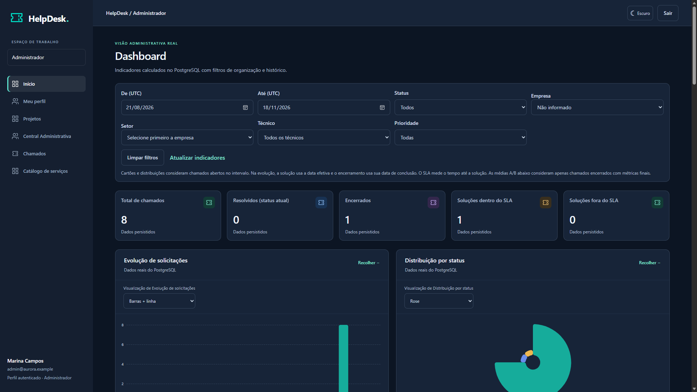
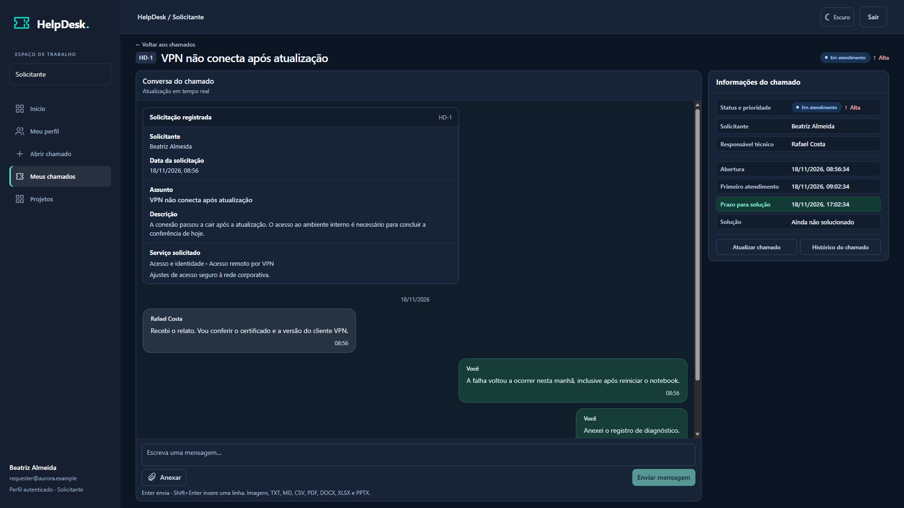
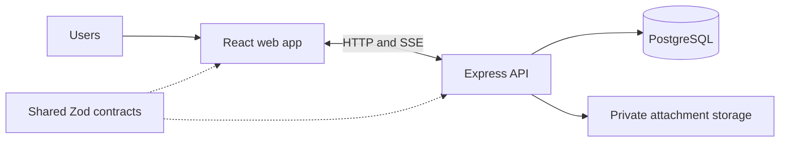

# HelpDesk

**Chamados de suporte de TI e acompanhamento de projetos em uma plataforma responsiva.**

HelpDesk is a portfolio project for organizing IT support requests, service operations, and project work. It is a local development and validation candidate; production deployment and external integrations are outside the documented scope.

## In action

These screens were captured from HelpDesk running locally with fictitious companies, accounts, tickets, and projects.






See the [full screenshot gallery](docs/screenshots/README.md) for project tracking, service management, and role-specific views.

## Features

| Area               | Current capabilities                                                                                                                                   |
| ------------------ | ------------------------------------------------------------------------------------------------------------------------------------------------------ |
| Tickets            | Request forms, service catalog, triage, priority, assignment, work, pending periods, resolution, conversations, and audit history.                     |
| Service operations | Versioned service forms, working schedules, operational policies, and business-time calculations for tickets.                                          |
| Projects           | Requests, assignment, versioned plans, stages and activities, derived progress, conversations, and auditable workflow. Project progress is not an SLA. |
| Communication      | Persisted conversations with SSE refresh and private, authorized attachments.                                                                          |
| Dashboards         | Role-scoped operational views for REQUESTER, TECHNICIAN, and ADMIN.                                                                                    |
| Administration     | Users, organizations, technician records, catalog, forms, schedules, and operational policies.                                                         |

### Access roles

| Role       | Scope                                                                                                                                  |
| ---------- | -------------------------------------------------------------------------------------------------------------------------------------- |
| REQUESTER  | Open and follow their own tickets and project requests, read permitted plans and history, and participate in authorized conversations. |
| TECHNICIAN | Work on assigned tickets and projects, subject to current ownership and workflow rules.                                                |
| ADMIN      | Use administrative views and the management actions explicitly granted by the backend.                                                 |

The server enforces permissions and resource ownership. Interface controls do not grant access. See the [current functional contract](docs/v1-contrato.md) and [project workflow](docs/37-workflow-projetos.md).

## Architecture



| Layer                | Technology                                                        |
| -------------------- | ----------------------------------------------------------------- |
| Frontend             | React, TypeScript, Vite, Tailwind CSS, ECharts, and GSAP          |
| Backend              | Node.js, Express, TypeScript, Zod, and Prisma                     |
| Persistence          | PostgreSQL                                                        |
| Local infrastructure | Docker Compose                                                    |
| Authentication       | HttpOnly cookies, CSRF protection, revocable sessions, and Argon2 |
| Quality              | ESLint, Prettier, TypeScript, Jest, and frontend tests            |

### Repository layout

```text
helpdesk/
├── apps/backend/       # API, domain services, Prisma schema/migrations, and tests
├── apps/frontend/      # React application and browser tests
├── packages/contracts/ # Shared validation schemas and types
├── infra/              # Local PostgreSQL Compose configuration
├── scripts/            # Local setup and health checks
├── docs/               # Current contracts, guides, architecture, and history
├── planning/           # Backlog and traceability
├── .github/            # Repository workflows
├── .agents/ .claude/   # Agent instructions and adapters
├── skills/             # Shared task procedure
└── package.json        # npm workspaces and root commands
```

Environment files, installed dependencies, generated clients, local attachments, backups, logs, and test evidence are local artifacts and must not be committed.

## Local setup

### Requirements

- Node.js 24.x and npm 11.x.
- Docker Desktop or Docker Engine with Compose.
- PowerShell for the commands below.

### Configure and start PostgreSQL

From the repository root:

```powershell
npm ci
npm run env:setup
npm run auth:env:setup
npm run db:config
npm run db:up
npm run db:status
npm run db:check
```

The setup scripts create a root `.env` with local development settings and generated authentication secrets when needed; they preserve an existing file. Keep `.env` private and ignored. The Compose service uses a persistent named volume. Do not remove it to troubleshoot an application issue.

For a new local database only, check `.env`, confirm its target is the intended local development database, and then apply the repository migrations:

```powershell
npm run prepare:core --workspace @helpdesk/backend
npm run db:migrate:dev --workspace @helpdesk/backend
npm run db:migrate:status --workspace @helpdesk/backend
```

Do not run migrations against an unconfirmed database. Keep `helpdesk_dev` and `helpdesk_test` separate. The integration suite must use only its isolated test database.

### Development accounts

To create the local ADMIN and TECHNICIAN development accounts, use an interactive terminal that supports hidden password input:

```powershell
npm run provision:dev
```

The command preserves existing accounts and does not print or store the entered passwords. Create a REQUESTER through the registration page. Use synthetic names, aliases, and records only. Administrative setup such as organizations, schedules, categories, and published forms can then be completed in the application.

### Start the application

Run these commands in separate terminals from the repository root:

```powershell
npm run dev:backend
```

```powershell
npm run dev:frontend
```

Open [http://127.0.0.1:5173/#/login](http://127.0.0.1:5173/#/login). The API health check is [http://127.0.0.1:3001/health](http://127.0.0.1:3001/health); through the Vite proxy it is available at [http://127.0.0.1:5173/api/health](http://127.0.0.1:5173/api/health).

| Service    | Default local address |
| ---------- | --------------------- |
| Frontend   | `127.0.0.1:5173`      |
| API        | `127.0.0.1:3001`      |
| PostgreSQL | `127.0.0.1:5432`      |

Local HTTP services bind to loopback by default. Use a separate configuration, ports, and database volume for a second instance.

## Quality checks

Run checks from the root. Avoid running multiple commands that generate Prisma Client at the same time.

```powershell
npm run lint
npm run format:check
npm run prisma:validate --workspace @helpdesk/backend
node --import tsx --test apps/frontend/tests/*.test.ts
npm run typecheck --workspace @helpdesk/frontend
npm run build --workspace @helpdesk/frontend
npm run typecheck --workspace @helpdesk/backend
npm run build --workspace @helpdesk/backend
npm run test --workspace @helpdesk/backend
```

The backend workspace hooks prepare shared contracts and Prisma Client before its typecheck, build, and unit tests. Run these commands sequentially. For database integration tests, first verify the isolated test target, then use:

```powershell
npm run test:db --workspace @helpdesk/backend
```

Never point integration tests at a development or production database. See [local operation and recovery](docs/v1-operacao-local.md) for storage and recovery constraints.

## Security and privacy

The repository is public. Never commit `.env`, credentials, authentication material, database dumps, private attachments, backups, real user records, or screenshots containing private data. The checked-in `.env.example` is a template; keep secret fields blank or clearly fictitious. Do not expose server-only environment variables through the frontend build.

Uploads are stored privately and require authorization for access. A complete recovery set includes PostgreSQL data and matching private attachment bytes; a database dump alone is insufficient. Keep backups and recovery evidence outside Git with restricted access.

For vulnerability reports, do not open a public issue. The [GitHub private advisory page](https://github.com/joaoMia/helpdesk/security/advisories/new) is the intended private route if private vulnerability reporting is enabled. Its enablement could not be verified from the available read-only repository metadata; the repository owner should confirm the setting before directing reporters there. See [SECURITY.md](SECURITY.md).

This project is released under the [MIT License](LICENSE). Dependencies retain their own licenses. The local development instructions are not a production deployment guide.

## Documentation

Start at the [documentation index](docs/README.md) for current contracts, operating guides, architecture, historical records, and backlog links.

## Maintainer

Portfolio project by [João Pedro Miá](https://github.com/joaoMia), released under the [MIT License](LICENSE).
